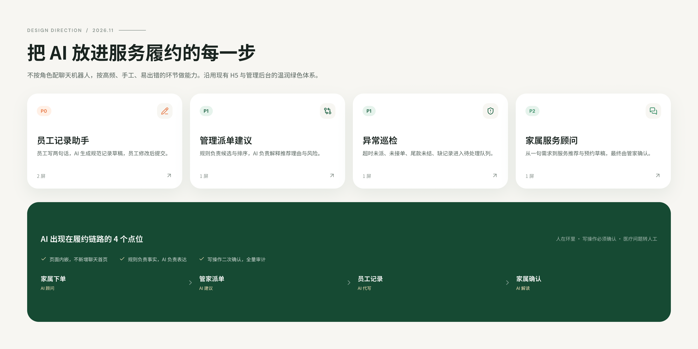
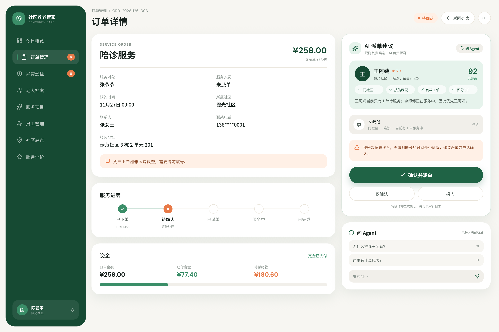
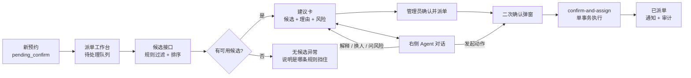
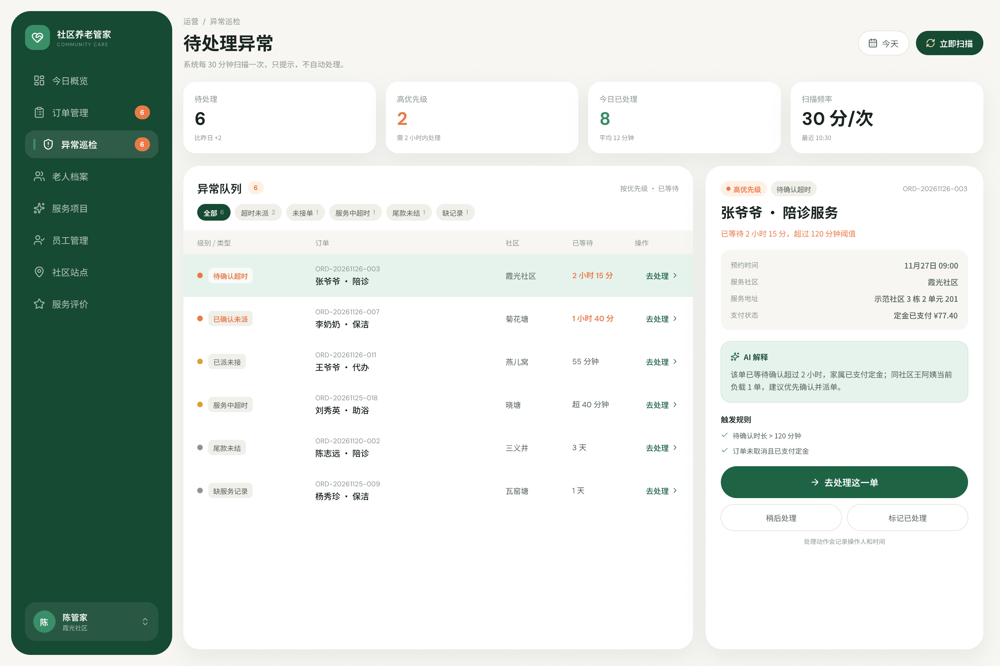

# 管理端 Agent 交互稿

> 状态：P1 交互设计，依赖数据底座
> 更新时间：2026-11-26
> 对应方案：[Agent能力规划.md](Agent能力规划.md)
> 数据底座：[Agent数据底座概要设计.md](Agent数据底座概要设计.md)
> 设计稿：[Agent能力设计稿.md](Agent能力设计稿.md)
> 说明：管理端不是第一期。P0 是员工服务记录助手；本篇描述 P1 的派单建议与异常巡检。

## 1. 范围与前提

只做两条流程：

1. **新预约处理**：新预约进入 → 规则生成候选 → AI 解释 → 管理员确认 → 确认 + 派单。
2. **异常巡检**：定时扫描 → 待处理队列 → 单条解释 → 人工处理。

不做：

- 尾款催收
- 自动确认 / 自动派单
- 跨区域派单
- 自动退款 / 改价

前提（没有这些，交互就是空壳）：

- 员工排班、每日容量、请假/停用数据；
- 候选查询接口；
- 组合式「确认 + 派单」事务接口；
- 定时任务与异常队列表。

详见 [Agent数据底座概要设计.md](Agent数据底座概要设计.md)。

交互形态固定为：**工作台 + 详情 + 右侧 Agent 对话**。规则负责候选与判定，AI 负责解释，管理员负责确认。

---

## 2. 入口



三个入口：

1. 左侧导航「派单工作台」，角标显示待确认/待派单数。
2. 左侧导航「异常巡检」，角标显示待处理异常数。
3. 今日概览引导卡，只提示待派单和异常，不混入尾款。

入口原则：

- 两个一级菜单分开：派单是主动作，异常是兜底。
- 角标数字必须来自后端实时统计，不用前端估算。
- 管理端不出现「通用聊天」入口，对话只在当前订单上下文里打开。

---

## 3. 流程 A：新预约 → 建议 → 确认派单





一句话：**规则负责候选，AI 负责解释，管理员负责确认。**

### 3.1 工作台结构

- 顶部指标：待确认、待派单、今日已派、今日已处理。
- 队列：新预约按到达时间排序，选中项与 URL 绑定。
- 详情：订单事实 + 建议卡 + 风险 + 候选员工。
- 右上角：`问 Agent`，打开右侧抽屉，自动带入当前订单。

### 3.2 建议卡

建议卡必须包含「为什么」，不能只给结论。

```text
推荐 王阿姨

· 同社区：霞光社区
· 技能匹配：陪诊
· 可用时间：11月27日 09:00–13:00
· 当前负载：1 / 4 单
· 评分：5.0

备选 李师傅：同社区、会陪诊，但当前有 1 单服务中。
风险：排班数据未接入，无法判断预约时间是否请假；派单前请电话确认。
```

要求：

- 每条理由都来自后端规则结果，不能让 LLM 自由编造。
- 「可用时间」「负载」「评分」缺失时，显示数据缺口，不假装有数据。
- 候选员工必须显示头像、姓名、站点、技能、当前负载、评分。

### 3.3 候选规则

硬过滤（不满足直接排除）：

1. 同站点、在职、角色为 staff；
2. 技能匹配服务要求；
3. 预约日期在员工工作日内；
4. 预约时段落在工作时间内；
5. 与服务中的其他订单不冲突；
6. 当日负载未超过容量。

排序（总分 100）：

| 维度 | 权重 | 说明 |
|---|---|---|
| 技能匹配 | 40 | 完全匹配得满分，否则排除 |
| 可用性 | 20 | 工作日、时段、请假都满足 |
| 负载 | 20 | 越接近容量得分越低 |
| 评分 | 10 | `rating / 5 × 10` |
| 同社区 | 10 | 老人社区与员工服务社区一致 |

无候选时，必须返回「被哪条规则排除」的明细，例如：

```text
同社区暂无匹配「助浴」技能的在岗员工
· 菊花塘社区当前无可用助浴员工
· 跨区员工不允许自动派单
· 建议改约，或协调其他站点支援
[转管家协调] [联系家属改约] [稍后处理]
```

### 3.4 操作

- `确认并派单`：主操作，打开二次确认。
- `仅确认`：只确认订单，暂不派单，留在待派单队列。
- `换人`：只在系统候选内切换，不允许搜索任意员工。
- `稍后处理`：留在队列。
- `问 Agent`：打开右侧对话。

### 3.5 确认弹窗

点击「确认并派单」后先弹二次确认：

- 订单号
- 老人 / 服务
- 服务人员
- 服务区域
- 预约时间
- 风险提示
- `取消` / `确认执行`

确认弹窗的作用：

- 防止误点；
- 明确「确认 + 派单」是一个组合动作；
- 把风险放在执行前最后一次展示。

### 3.6 成功与失败

成功：

- 当前订单变为「已派单」；
- 队列移除当前单，自动选中下一条；
- 显示「已确认并派单给 XXX」；
- 写入审计日志；
- 通知员工和家属。

失败：

- `confirm-and-assign` 必须在单事务内完成，**不允许前端串两个请求假装成功**。
- 订单状态已变化、员工不可用、区域不匹配时，返回 409/400，并给出具体原因。
- 通知失败不回滚业务，但记录失败日志并允许重试。

---

## 4. 流程 B：异常巡检



### 4.1 扫描类型

| 类型 | 判定 | 默认阈值 | 级别 |
|---|---|---|---|
| 待确认超时 | `pending_confirm` 超过阈值 | 120 分钟 | 高 |
| 已确认未派 | `confirmed` 超过阈值 | 60 分钟 | 高 |
| 已派未接 | `assigned` 且派单未接受 | 30 分钟 | 中 |
| 服务中超时 | `in_service` 超过预计结束时间 | 60 分钟 | 中 |
| 尾款未结 | `completed` 且 `remaining_cents > 0` | 24 小时 | 低 |
| 缺服务记录 | `completed` 但无记录 | 立即 | 低 |

阈值全部配置化，不写死在代码里。

### 4.2 队列

- 顶部指标：待处理、高优先级、今日已处理、平均处理时长、扫描频率。
- 列表按「级别 + 已等待」排序。
- 筛选：全部 / 超时未派 / 未接单 / 服务中超时 / 尾款未结 / 缺记录。
- 选中行展开右侧详情，选中状态与 URL 绑定。

### 4.3 详情

- 订单事实：老人、服务、预约时间、社区、地址、支付状态。
- AI 解释：为什么被标记、建议先做什么。
- 触发规则：具体命中了哪一条。
- 操作：`去处理这一单`、`稍后处理`、`标记已处理`。

### 4.4 处理原则

- 只提示，不自动处理。
- 「去处理」跳转到订单详情，不在这里直接改状态。
- 「稍后处理」设置 snooze 时间，到期重新出现。
- 「标记已处理」必须记录操作人和备注。
- 条件消失后，定时任务自动把任务标记为 `resolved`，避免队列堆积。

---

## 5. 右侧 Agent 对话

### 5.1 入口

工作台右上角固定 `问 Agent`。点击后从右侧打开抽屉，背景保留当前工作台和当前选中订单。

### 5.2 上下文

对话自动带入：

- 当前选中的订单；
- 当前建议员工；
- 当前风险；
- 当前用户角色。

顶部显示：

```text
已带入当前订单：ORD-20261126-003 · 张爷爷 · 陪诊
```

### 5.3 能问什么

- 「为什么推荐王阿姨？」
- 「这单有什么风险？」
- 「换一个员工看看」
- 「她今天几单？」
- 「那就确认并派给她」
- 「处理下一条」

### 5.4 对话里的写操作

对话只能生成动作卡，不能直接执行：

```text
确认并派单 · 王阿姨
这是写操作，需要你确认后才会执行；不会自动派单。

[确认执行] [取消]
```

点击「确认执行」仍然进入确认弹窗，不跳过确认。

### 5.5 对话边界

- 只围绕当前订单和异常队列。
- 尾款问题引导到订单管理，不做催收队列。
- 不回答与当前权限无关的订单。
- 不确定时转人工，不编造员工可用性。
- 不通过对话直接退款、改价、跨区派单。

---

## 6. 关键状态

| 节点 | 页面表现 | 用户动作 | 系统反馈 |
|---|---|---|---|
| 新单进入 | 队列新增，角标 +1 | 选中订单 | 右侧加载建议 |
| 生成建议 | 建议卡 + 候选 + 风险 | 查看理由 | 可换人 |
| 点击确认 | 二次确认弹窗 | 取消 / 确认执行 | 按钮 loading |
| 执行成功 | 状态变「已派单」，队列移除 | 处理下一条 | 通知 + 审计 |
| 执行失败 | 显示具体原因 | 重试 / 换人 | 保留原状态 |
| 无可用员工 | 异常卡 + 排除原因 | 转管家 / 改约 | 记录异常原因 |
| 对话提问 | 右侧抽屉，带入当前订单 | 追问 / 换人 | 结构化解释 |
| 对话发起动作 | 动作卡 + 确认按钮 | 确认执行 | 仍走确认弹窗 |
| 异常扫描 | 队列新增/消失 | 去处理 / 稍后 | 自动 resolve |

---

## 7. 交互细节

- 队列选中和 URL 状态绑定，刷新后保留当前订单。
- 确认按钮请求期间禁用，防止双击重复派单。
- 每个动作带 `Idempotency-Key`，后端幂等。
- 所有动作写审计：谁、什么时候、对哪个订单、派给谁。
- 对话里的动作卡和页面按钮走同一个后端动作。
- 对话打开时不遮挡左侧队列。
- 失败提示要具体：区域不匹配、员工不可用、订单状态已变、时间冲突。
- 异常队列的「稍后处理」必须有过期时间，不能永久隐藏。

---

## 8. 与数据底座的依赖

| 交互能力 | 依赖 | 文档章节 |
|---|---|---|
| 建议卡候选 | 员工排班/容量/可用时间 | 数据底座 §5.1 |
| 候选排序与排除原因 | 候选查询服务 | 数据底座 §5.2 |
| 确认并派单 | 单事务 `confirm-and-assign` | 数据底座 §5.3 |
| 异常队列 | 定时任务 + `admin_tasks` | 数据底座 §5.4 |
| 对话动作审计 | `agent_actions` + `audit_logs` | 数据底座 §5.5 |
| 风险提示 | 排班数据缺口标记 | 数据底座 §5.1 |

---

## 9. 暂不做

- 尾款催收
- 纯聊天入口
- 自动确认 / 自动派单
- 跨区域自动派单
- 自动退款 / 改价
- 自动短信 / 微信发送
- 管理端自然语言报表

---

## 10. 待确认

1. 无可用员工时，是否允许「仅确认」？建议允许。
2. 对话里的「确认执行」是否必须再走一次确认弹窗？建议必须。
3. 对话中的「换人」只允许在系统候选里换，还是允许管理员指定任意同区员工？建议只允许候选内换。
4. 「稍后处理」默认 snooze 多久？建议 2 小时。
5. 异常队列是否允许批量标记已处理？建议首期不开放。
