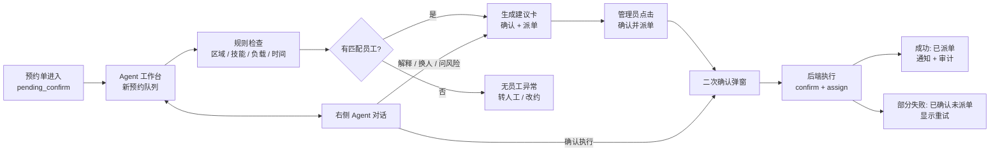

# 管理端 Agent 交互稿

> 状态：交互讨论稿，未实现  
> 更新时间：2026-11-25  
> 对应方案：[Agent能力规划.md](Agent能力规划.md)  

## 1. 本期范围

只做一个端：**管理端 Agent**。

只做一条主流程：

```text
预约单进入
  → Agent 检查并推荐
  → 管理员确认
  → 确认 + 派单
```

本期**不做尾款催收**。尾款催收不进入 Agent 工作台，后续单独设计。

交互形态是：

```text
工作台 + 对话
```

- 工作台：批量处理新预约，看队列、建议、风险。
- 对话：解释建议、换人、问风险、发起动作。
- 对话不能绕过确认直接执行写操作。

## 2. 入口

两个入口：

1. 左侧导航新增 **Agent 工作台**，角标显示新预约待处理数。
2. 今日概览增加引导卡，可直接进入。


入口原则：

- Agent 工作台是独立一级菜单，不藏在订单详情里。
- 角标只显示新预约数，不混入尾款数。
- 今日概览只提示新预约处理，不提示催收。

## 3. 主流程



一句话：**规则负责选单和候选人，Agent 负责解释和对话，管理员负责确认执行。**

## 4. 新预约工作台


页面结构：

- 顶部指标：新预约、待派单、今日已派、今日已处理
- 队列：待处理预约，按新到优先
- 详情：订单事实 + Agent 建议 + 风险 + 候选员工
- 右上角：`问 Agent` 打开对话抽屉

### 4.1 建议卡

```text
Agent 建议
建议确认，并派给 王桂芳

· 同区域：霞光社区
· 技能匹配：陪诊
· 当前负载：1 单
· 评分：4.9

风险提示：家属还未支付定金 ¥77.40。
不影响确认和派单，但员工开始服务前必须完成支付。
```

建议卡必须包含“为什么”，不能只给结论。

### 4.2 操作

- `确认并派单`：主操作，打开二次确认
- `仅确认`：只确认订单，暂不派单
- `换人`：在候选中切换
- `稍后处理`：留在队列
- `问 Agent`：打开右侧对话

## 5. 确认弹窗


点击“确认并派单”后，先弹二次确认：

- 订单号
- 老人 / 服务
- 服务人员
- 服务区域
- 预约时间
- 风险提示
- `取消` / `确认执行`

确认弹窗的作用：

- 防止误点
- 明确“确认 + 派单”是组合动作
- 把风险放在执行前最后一次展示

## 6. 执行成功


成功后：

- 当前订单变为“已派单”
- 队列移除当前单
- 自动选中下一条
- 显示“已确认并派单给 XXX”
- 写入审计日志
- 通知员工和家属

不要只弹 toast 就结束，管理员需要确认“这单真的进去了”。

## 7. 无可用员工


异常状态不硬派：

```text
同区域暂无匹配“助浴”技能的在岗员工

· 菊花塘社区当前无可用助浴员工
· 其他区域员工不允许跨区派单
· 不要硬派无技能员工
· 建议改约或协调支援

[转管家协调] [联系家属改约] [稍后处理]
```

原则：

- 不跨区域自动派单
- 不派无技能员工
- 异常交给人工
- 记录异常原因

## 8. Agent 对话


### 8.1 入口

工作台右上角固定 `问 Agent`。

点击后从右侧打开对话抽屉，背景保留当前工作台和当前选中的订单。

### 8.2 上下文

对话自动带入：

- 当前选中的订单
- 当前建议员工
- 当前风险
- 当前用户角色

顶部显示：

```text
已带入当前订单：ORD... · 王爷爷 · 陪诊
```

这样用户不用重复说“我说的是哪一单”。

### 8.3 能问什么

示例：

- “为什么推荐王桂芳？”
- “这单有什么风险？”
- “换一个员工看看”
- “她今天几单？”
- “那就确认并派给她”
- “处理下一条”

### 8.4 对话里的写操作

对话可以生成动作卡，但不能直接执行：

```text
确认并派单 · 王桂芳
这是写操作，需要你确认后才会执行；不会自动派单。

[确认执行] [取消]
```

点击“确认执行”仍然进入确认弹窗，不跳过确认。

### 8.5 对话边界

- 本期对话只围绕新预约处理。
- 尾款问题引导到订单管理，不做催收队列。
- 不回答与当前权限无关的订单。
- 不确定时转人工，不编造员工可用性。
- 不通过对话直接退款、改价、跨区派单。

## 9. 关键状态

| 节点 | 页面表现 | 用户动作 | 系统反馈 |
|---|---|---|---|
| 新单进入 | 队列新增，角标 +1 | 选中订单 | 右侧加载建议 |
| 生成建议 | 建议卡 + 候选员工 + 风险 | 查看理由 | 可换人 |
| 点击确认 | 二次确认弹窗 | 取消 / 确认执行 | 按钮 loading |
| 执行成功 | 状态变“已派单”，队列移除 | 处理下一条 | toast + 通知 + 审计 |
| 执行失败 | 显示“已确认，派单失败” | 重试 / 换人 | 保留已确认状态 |
| 无可用员工 | 异常卡 + 转人工 | 转管家 / 改约 | 记录异常原因 |
| 对话提问 | 右侧抽屉，带入当前订单 | 追问 / 换人 | 结构化解释 |
| 对话发起动作 | 动作卡 + 确认按钮 | 确认执行 | 仍走确认弹窗 |

### 部分失败

```text
确认成功，但派单失败
订单现在是“已确认”，员工还未派单
[重试派单] [换人] [查看订单]
```

不能把“确认 + 派单”做成前端串两个请求后假装都成功。

## 10. 交互细节

- 队列选中和 URL 状态绑定，刷新后保留当前订单。
- 刷新队列不丢失当前选中项。
- 确认按钮请求期间禁用，防止双击重复派单。
- 每个动作有 `action_id`，后端幂等。
- 所有动作写审计：谁、什么时候、对哪个订单、派给谁。
- 对话里的动作卡和页面按钮走同一个后端动作。
- 对话打开时不遮挡左侧队列，管理员仍能看到上下文。
- 失败提示要具体：区域不匹配、员工不可用、订单状态已变。

## 11. 暂不做

- 尾款催收
- 纯聊天入口
- 自动确认 / 自动派单
- 跨区域自动派单
- 自动退款 / 改价
- 自动短信 / 微信发送
- 员工端、家属端 Agent

## 12. 需要确认

1. 无可用员工时，是否允许“仅确认”？
2. 对话里的“确认执行”是否必须再走一次确认弹窗？建议必须。
3. 对话中的“换人”只允许在系统候选里换，还是允许管理员指定任意同区员工？建议只允许候选内换。
