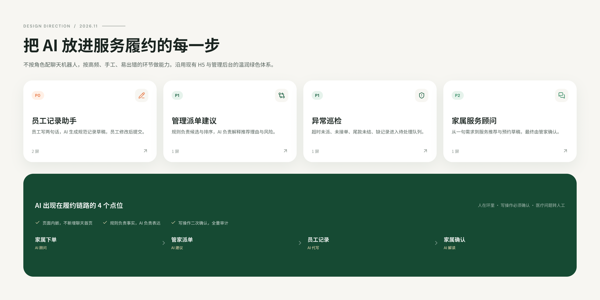
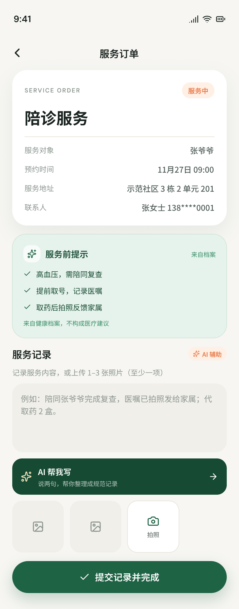
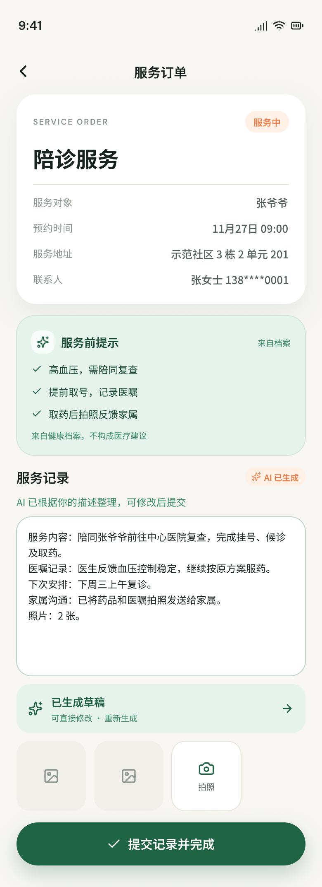
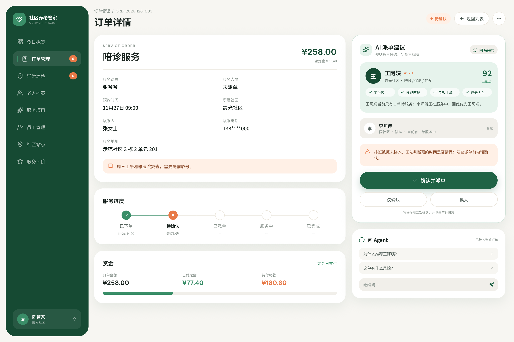
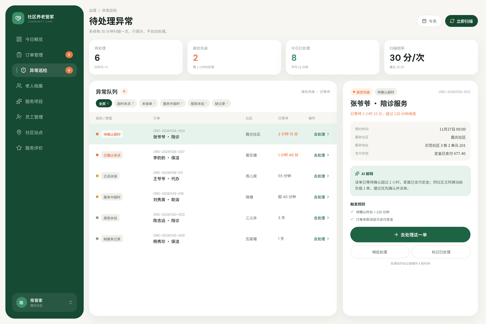
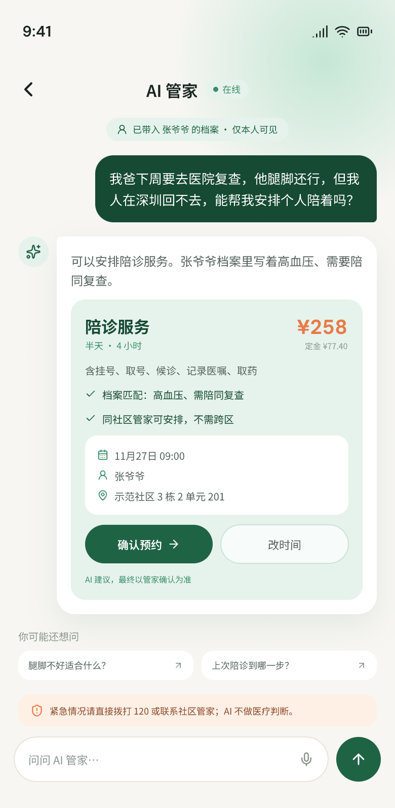

# Agent 能力设计稿

> 对应方案：[Agent能力规划.md](Agent能力规划.md)
> 设计源文件：[design/agent-capabilities.pen](design/agent-capabilities.pen)
> 导出图：[design/agent-capabilities/](design/agent-capabilities/)
> 状态：设计基线，未实现
> 更新时间：2026-11-26

## 1. 设计范围

本设计稿只覆盖方案中确定要做的能力，不按「家属端 / 员工端 / 管理后台」各配一个聊天机器人。

| 优先级 | 能力 | 屏幕 | 说明 |
|---|---|---|---|
| P0 | 员工服务记录助手 | 2 屏 | 记录页入口 + AI 草稿生成后 |
| P1 | 管理端派单建议 | 1 屏 | 订单详情 + 候选员工 + 风险 + 问 Agent |
| P1 | 异常巡检队列 | 1 屏 | 待处理异常列表 + 单条解释 + 处理动作 |
| P2 | 家属服务顾问 | 1 屏 | 一句话需求 → 服务推荐 → 预约草稿 |
| — | 设计总览 | 1 屏 | 四个能力点位与设计原则 |

## 2. 沿用现有风格

色板直接取自 [UI设计规范.md](UI设计规范.md)：

| Token | 色值 | 用途 |
|---|---|---|
| `brand-deep` | `#164A33` | 侧边栏、深色 CTA |
| `brand-primary` | `#1F6345` | 主按钮、强调文字 |
| `brand-mint` | `#3A8E68` | 勾选、进度、成功态 |
| `brand-soft` | `#E6F3EC` | AI 提示卡、推荐卡底 |
| `accent-coral` | `#E87A48` | 高优先级、待处理、金额 |
| `accent-peach` | `#FFF0E6` | 风险提示、状态胶囊 |
| `canvas-bg` | `#F7F6F2` | 全局底色 |
| `ink-primary` | `#1A2420` | 主文字 |
| `ink-secondary` | `#54615B` | 次级正文 |
| `ink-muted` | `#8C9690` | 辅助说明 |

- 移动端继续用 390 宽度、大圆角白卡、柔和绿色阴影。
- 管理后台沿用深绿悬浮侧栏 + 白色大圆角数据卡片。
- 中文字体 `Noto Sans SC`，数字与英文标签 `DM Sans`。
- 不新增独立聊天首页，AI 以按钮、卡片、右侧抽屉的形式嵌入现有页面。

## 3. 屏幕

### 00 · 设计总览

四个能力卡对应 P0 / P1 / P1 / P2，底部是履约链路与设计原则：页面内嵌、规则负责事实、写操作二次确认。

### 01 · 员工端：服务记录（AI 入口）

- 订单信息保持现有结构，不新增页面。
- 服务前提示来自老人健康档案，明确标注「不构成医疗建议」。
- 记录区上方是「AI 帮我写」主入口，副文案说明「说两句，帮你整理成规范记录」。
- 提交仍走现有按钮，AI 不自动提交。

### 02 · 员工端：服务记录（AI 草稿生成后）

- AI 生成固定结构：服务内容 / 医嘱记录 / 下次安排 / 家属沟通 / 照片数。
- 草稿回填到 textarea，员工可改；按钮变为「已生成草稿 · 可直接修改 / 重新生成」。
- 医生的话只以「医生反馈」转述，不添加诊断或用药建议。

### 03 · 管理端：订单详情与派单建议

- 左侧是订单事实、服务进度、资金。
- 右侧 AI 卡只做三件事：给候选、给理由、给风险。
- 候选来自规则（同社区、技能、负载、评分），AI 不自由发挥。
- 风险区明确写出数据缺口：「排班数据未接入，无法判断预约时间是否请假」。
- 「确认并派单」仍需二次确认；「仅确认」「换人」是次级操作。
- 下方「问 Agent」带入当前订单，提供两个快捷问题。

### 04 · 管理端：异常巡检队列

- 顶部四个指标：待处理、高优先级、今日已处理、扫描频率。
- 列表按优先级和已等待时间排序，选中行展开右侧详情。
- 详情包含订单事实、AI 解释、触发规则、处理动作。
- 只提示、不自动处理；处理动作记录操作人和时间。

### 05 · 家属端：AI 服务顾问（P2）

- 入口是带上下文的对话，不新开聊天 Tab。
- 用户一句话描述需求，AI 推荐服务并生成预约草稿。
- 草稿卡展示服务、价格、包含项、匹配理由、时间/老人/地址。
- 确认前不写库，最终以管家确认为准。
- 底部固定医疗边界：「紧急情况请直接拨打 120 或联系社区管家；AI 不做医疗判断。」

## 4. 关键设计决策

1. **页面内嵌优先**
   员工记录、派单建议都发生在已有页面里，AI 是按钮/卡片，不是新入口。

2. **规则负责事实，AI 负责表达**
   派单候选、异常判定、权限过滤都由后端规则完成；LLM 只解释和生成文字。

3. **人在环里**
   记录草稿不自动提交，派单不自动执行，异常不自动处理；所有写操作二次确认并审计。

4. **医疗边界可见**
   服务前提示和家属顾问都在界面上明确写出「不构成医疗建议」「紧急情况拨打 120」。

5. **数据缺口要诚实**
   派单卡直接暴露「排班数据未接入」，不假装 AI 什么都知道。

## 5. 与方案的对应关系

- **P0 员工记录助手**：第 01、02 屏。
- **P0.5 数据地基**：不单独出图，体现在派单卡的风险提示里。详细设计见 [Agent数据底座概要设计.md](Agent数据底座概要设计.md)。
- **P1 派单建议**：第 03 屏。
- **P1 异常巡检**：第 04 屏。
- **P2 家属顾问**：第 05 屏。

## 6. 本设计稿未包含

- 老人端 Agent。
- 家属/员工的纯查询聊天。
- 管理端自然语言报表。
- 自动派单、自动退款、自动改价。
- 多轮会话持久化与历史列表。

这些在 [Agent能力规划.md](Agent能力规划.md) 中已明确不做或暂不排期。
